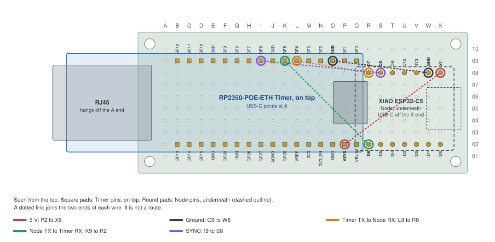
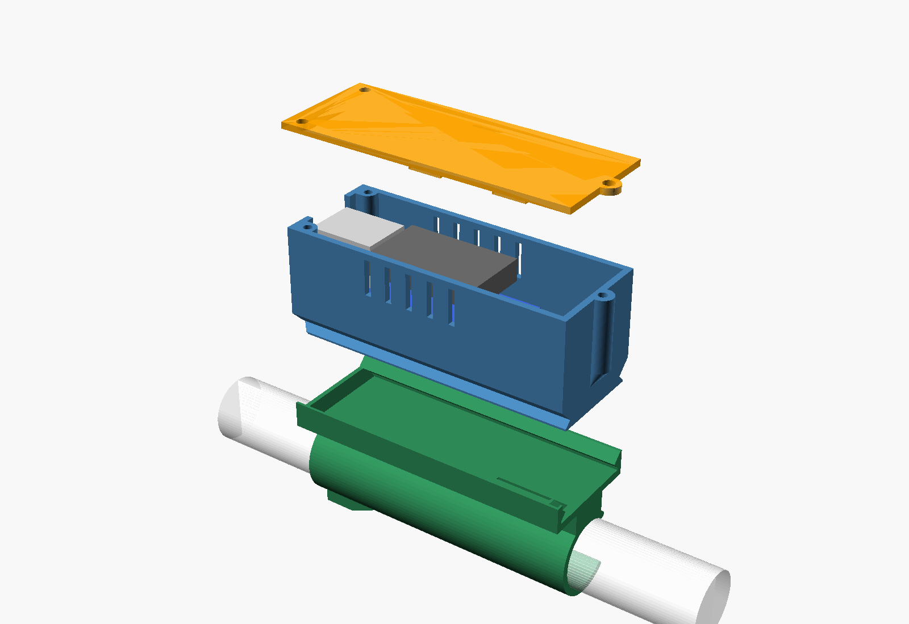
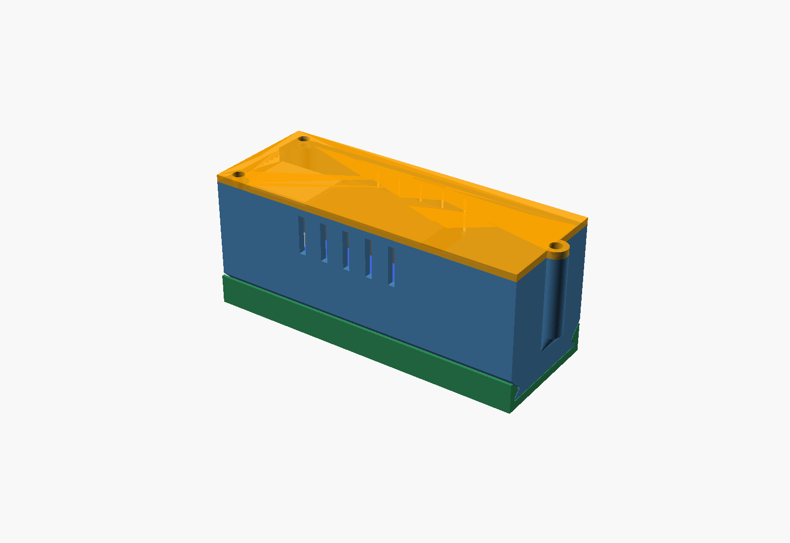

# b1-proto-30x70: one-Node Timer on a 30 x 70 mm protoboard

The compact build of B1: one Waveshare RP2350-POE-ETH Timer on top of a small protoboard and
one Seeed XIAO ESP32-C5 Node underneath it, joined by five wires. Built by Ryan on 2026-11-28;
the positions below are his, read off the built board.

This is the one-Node build to make. It replaces the first protoboard build (57 x 51 mm, both
boards side by side on top), which is gone from this repo along with its case: do not build
that one. The case for this build is below.

## The board

| | |
|---|---|
| Size | 30 x 70 mm |
| Holes | 10 x 24 on a 2.54 mm grid |
| Hole names | numbers `01` to `10` across the short side, letters `A` to `X` along the long side |
| Mounting | a hole in each corner. They look like M2; not measured |

A hole is named letter then number: `B2` is the second hole along, second across.

## Where the two boards go

**Timer, on top**, component side up, RJ45 at the `A` end, USB-C pointing at `X`.

| Timer pin | Hole |
|---|---|
| GP13 (pin 17) | `B2` |
| GP12 (pin 16) | `B9` |
| VBUS (pin 32) | `Q2` |
| GP0 (pin 1) | `Q9` |

Its two rows of 16 pins run from `B` to `Q`, in rows `2` and `9`.

**Node, underneath**, component side facing away from the board, USB-C at the `X` end.

| Node pin | Hole |
|---|---|
| D0 | `X2` |
| 5V | `X8` |
| D6 | `R2` |
| D7 | `R8` |

Its two rows of 7 pins run from `R` to `X`, in rows `2` and `8`. The two boards share no
column: the Timer ends at `Q`, the Node starts at `R`.

Every pin, both boards:

| Row | B | C | D | E | F | G | H | I | J | K | L | M | N | O | P | Q |
|---|---|---|---|---|---|---|---|---|---|---|---|---|---|---|---|---|
| **9** (Timer) | GP12 | GP11 | GP10 | GND | GP9 | GP8 | GP7 | **GP6** | GND | **GP5** | **GP4** | GP3 | GP2 | GND | GP1 | GP0 |
| **2** (Timer) | GP13 | GP14 | GP15 | GND | GP22 | RUN | GP26 | GP27 | AGND | GP28 | ADC_VREF | 3V3 | 3V3_EN | GND | **VSYS** | VBUS |

| Row | R | S | T | U | V | W | X |
|---|---|---|---|---|---|---|---|
| **8** (Node) | **D7** | **D8** | D9 | D10 | 3V3 | **GND** | **5V** |
| **2** (Node) | **D6** | D5 | D4 | D3 | D2 | D1 | D0 |

## The five wires

These are the Timer's default pins, so a freshly flashed Timer needs no setup.

| Signal | Timer pin | Hole | Node pin | Hole |
|---|---|---|---|---|
| 5 V | VSYS (pin 31) | `P2` | 5V | `X8` |
| Ground | GND | `O9`, or any Timer GND | GND | `W8` |
| Timer TX to Node RX | GP4 (pin 6) | `L9` | D7 | `R8` |
| Node TX to Timer RX | GP5 (pin 7) | `K9` | D6 | `R2` |
| SYNC | GP6 (pin 9) | `I9` | D8 | `S8` |

- **Take 5 V from VSYS at `P2`, not VBUS beside it at `Q2`.** VBUS is the Timer's USB power
  only, and is dead on PoE.
- **All five wires run on the top side**, as built. At the Timer end, a wire does not go to
  the Timer's pin itself, which is under the Timer: its bare end goes down through a spare
  hole in the outer row beside that pin and is bridged, on the underside, to the pin's solder
  joint. At the Node end it is soldered straight to the tip of the Node's pin, which sticks
  up through the board.
- Ryan's note says row `1` for the Timer end. Row `1` is the outer row beside VSYS (`P2`) and
  the other row-`2` pins; the outer row beside GP4, GP5, GP6 and the GND at `O9` is row
  `10`. Which holes each wire used was not recorded, and neither was which GND pin (the
  Timer has GND at `E9`, `J9`, `O9`, `E2` and `O2`; `O9` is the one drawn).
- The drawing joins each pair with a dotted line, which is not a route.
- Nothing is wired to the pads on the back of the XIAO: SYNC is on D8, and the Timer restarts
  and updates the Node over the two data wires
  ([oft-timer-rp2350](https://github.com/Open-FPV-Timer/oft-timer-rp2350)).

## Things to keep reachable

- **Recovery jumper:** GP9 at `F9` to the GND next to it at `E9`. Fitted at power-up, it makes
  the Timer use DHCP and the default Node pins for that start.
- **The Timer's RESET and BOOT buttons.** A Timer that hangs needs RESET; the first firmware
  install needs BOOT.
- **The Node's BOOT and RESET buttons, or its USB-C port** at the `X` end, underneath. They
  are the way back for a Node whose firmware update was cut off by a power loss.

## Worked out from the drawings, not measured

From Waveshare's and Seeed's dimension drawings (the same numbers `gen/parts.py` uses).
Check them against the built board.

- **Overhang at the `A` end:** the Timer's board runs about 15 mm past the end of the
  protoboard, and the RJ45 jack about 3 mm further.
- **The Node's back faces the protoboard.** Its underside pads (EN, BOOT, battery, JTAG) look
  at the protoboard's underside. The Timer's solder joint at `Q2`, which is VBUS, comes
  through one column from the Node's end and under its corner. Trim it flush and make sure
  nothing on the Node's back can touch it.
- **The Timer's USB-C plug lies over columns `R` to `X` on the top side**, between rows 3 and
  8 or so. The Node's joints in rows `2` and `8` come through there: trim them low so a plug
  fits.
- **The Node's USB-C port** ends about 3 mm inside the protoboard's `X` end, so a plug goes in
  from the end, underneath.

## The case

`case.scad` (OpenSCAD) is a screw-closed box with slide-on bases. **Drawn, not yet printed.**
Its slide rail, pipe clip and strap saddle are taken from the first protoboard case, which
was printed and fitted; everything about how this board sits in it is new.

| Part | What it does | How to print |
|---|---|---|
| `body` | Open box. The board sits on four corner posts, held by an M2 x 5 screw in each corner hole. The Node hangs below the board, the Timer stands above it | Floor down, as exported. No supports |
| `lid` | Closes the box with three M3 screws; a tab fills the wall above the Ethernet jack | Outer face down, as exported. No supports |
| `base-flat` | Plate for sitting on the ground. Its sides are flush with the case's | Plate down, as exported. No supports |
| `base-pvc-half-inch`, `base-pvc-three-quarter-inch` | Snap-on pipe clip with an M3 set screw against rotation | Standing on its far end, as exported. No supports |
| `base-strap` | Saddle with one tunnel for a 20 mm strap | Standing on its far end, as exported. No supports |

Case 91 x 35 x 37 mm (95 mm over the lid's end lug). A base adds 3 mm underneath and nothing
at the sides.

- **One opening, for the Ethernet jack.** To reach either USB-C port, take the lid off, undo
  the four M2 screws and lift the board out.
- **Nothing sticks out of the long sides.** The lid's screws are inside the two Ethernet-end
  corners and on the far end wall, so a base is exactly as wide as the case. The dovetail
  foot is set in from the sides for the same reason: the base's rails sit under the case's
  sloped lower edges.
- **A base slides on from the Ethernet end** until the case meets the stop at the base's
  Ethernet end, and clicks. A pull on the Ethernet cable pushes the case into the stop. Pull
  the case towards the far end to take it off.
- **The antenna** has the space under the board and under the Timer's overhang. There is no
  hole for one.
- **Vents** in both long walls beside the PoE module.

### Hardware

- 4 x M2 x 5 screw: board to the corner posts. They cut their own thread.
- 3 x M3 screw, 8 to 12 mm: lid.
- Pipe base only: 1 x M3 screw, 8 or 10 mm, and 1 x M3 nut for the set screw.

### Building it

`./build.sh` exports the STLs and pictures to `out/` and checks that the parts, the
electronics and the pipe do not overlap. It needs Docker only. The pictures here are copied
from that run.

### Measure before printing

Parameters at the top of `case.scad`. The first three were not measured at all.

| Parameter | Value | What to measure |
|---|---|---|
| `mh_inset` | 2.0 | Centre of a corner mounting hole to each edge of the protoboard. **A guess.** The posts and their screw holes follow it |
| `under_h` | 10 | Depth below the protoboard that the Node, its USB-C and the antenna lead need |
| `board_t` | 1.6 | Protoboard thickness |
| `stack_h` | 17 | Top of the PoE module above the protoboard's top face. Measured on the first build, where the Timer sat the same way |
| `timer_over`, `jack_out` | 15.2, 2.9 | Timer board past the `A` end, and the jack past the Timer board. From Waveshare's drawing |
| `jack_z`, `jack_w`, `jack_h` | 4, 16, 13.5 | The jack: bottom above the protoboard, width, height |
| `head` | 4 | Room above the PoE module, for the wires that run on top |
| `fit`, `slide_fit` | 0.25, 0.25 | Board to walls, and foot to base |

Checked in the model only: the parts do not overlap each other, the mock electronics or the
pipe, and there is solid post under each corner screw. Not checked: any fit against real
parts, and these in particular.

- **Corner screws beside the PoE module.** The two corner holes at the `A` end are about
  2.5 mm from the Timer board's edge. If the PoE module is wider than the Timer board, a
  screwdriver may not reach them straight down.
- **The lid columns in the Ethernet-end corners** leave 0.6 mm to the Timer board's edge.
- **The wires on top** pass the corner screw heads and the outer rows; `head` and the
  2.5 mm beside the Timer are all the room they have.
- **The click tongue and the clips** carry over from a printed case, but on a narrower base.

## The drawing

`layout.py` writes `layout-top.svg` from the hole positions at its top, the same ones the
tables above use. Change a position there and run `python3 layout.py`.

An earlier drawing of this idea, on an 11-row board with the Node one row further in, is the
artifact "B1 Protoboard Layout". This document is the board as built.

## Licence

GPL-3.0-or-later, the same as the rest of this repo. See [LICENSE](../LICENSE).
